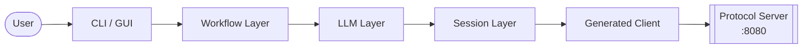

# NLI Engine

Natural-language interface engine for authoring CARP study protocols.

## Architecture



The engine receives free-text descriptions of a study protocol, maps them to API
calls via an LLM planner, and assembles the protocol on a running authoring server.

**Key principle:** `session_id` is managed entirely by the engine — the LLM never
sees it. Every API operation is exposed as a `BoundTool` with `session_id`
pre-filled and a Pydantic schema the LLM can use for structured output.

## Usage

### Install with CLI extras

```bash
uv sync --extra cli
```

### Basic interactive session

```bash
uv run nli-engine
```

### Run with configuration file

```bash
uv run nli-engine --config workflow.yaml
```

### Fully automated run with no prompts

```bash
uv run nli-engine \
  --workflow one_shot_llm \
  --name "my-study" \
  --prompt "record steps with the smartphone, heartbeat every hour" \
  --config workflow.yaml \
  --log-file run.jsonl
```

Type `exit` or press `Ctrl-C` to quit an interactive session.

### Flags reference

| Flag              | Default                 | Description                                                                                        |
| ----------------- | ----------------------- | -------------------------------------------------------------------------------------------------- |
| `--workflow ID`   | —                       | Skip the workflow selector and use this workflow directly                                          |
| `--name NAME`     | —                       | Protocol name; skips the interactive name prompt                                                   |
| `--prompt TEXT`   | —                       | Fire the first turn automatically; best combined with `--workflow` and `--name`                    |
| `--config PATH`   | —                       | Path to a workflow YAML config file                                                                |
| `--server URL`    | `http://localhost:8080` | Authoring server base URL                                                                          |
| `--log-file PATH` | —                       | Write a full JSON Lines session log (see [CLI design doc](docs/design/cli/cli.md#session-logging)) |
| `-v` / `-vv`      | —                       | Verbose trace: `-v` one-line events, `-vv` full debug blocks                                       |

### Workflow config

LLM workflows require a YAML config file that maps step names to model identifiers
and provides provider-specific parameters:

```yaml
# workflow.yaml
models:
  planner: "ollama/qwen2.5:7b" # or "gpt-4o", "anthropic/claude-sonnet-4-6", …
  refiner: "ollama/qwen2.5:7b" # used by one_shot_llm for the refinement step
parameters:
  api_base: "http://localhost:11434" # required for Ollama; omit for cloud providers
```

Model identifiers follow [LiteLLM's routing conventions](https://docs.litellm.ai/docs/providers).

### Available workflows

| ID             | Description                                                                                                         |
| -------------- | ------------------------------------------------------------------------------------------------------------------- |
| `dummy`        | Deterministic baseline — hard-codes the three setup tool calls; no LLM                                              |
| `dummy_llm`    | LLM-driven version — instructs the model to make the same calls autonomously                                        |
| `one_shot_llm` | Three-step pipeline: a refiner LLM clarifies the request, a planner LLM creates the plan, an executor LLM builds it |

## Evaluation

`nli-eval` reads session logs produced by `--log-file` and reports execution metrics.
No running engine or server required.

### Install with CLI extras

As with the engine, the evaluation CLI is included in the `cli` extra:

```bash
uv sync --extra cli
```

### Evaluate a single run

```bash
uv run nli-eval run run.jsonl
uv run nli-eval run run.jsonl --output metrics.json
```

### Evaluate a dataset

Provide a YAML manifest that maps each run log to its expected protocol output:

```yaml
# dataset/manifest.yaml
cases:
  - id: "001_diary_study"
    prompt: "record steps with the smartphone, heartbeat every hour"
    expected: cases/001_expected.json # relative to this file
    log: runs/001.jsonl
```

```bash
uv run nli-eval dataset dataset/manifest.yaml
uv run nli-eval dataset dataset/manifest.yaml --output results.json
```

See [eval design doc](docs/design/eval/eval.md) for the full metric reference and comparison model.

## Design docs

- [Session layer](docs/design/session_layer/session_layer.md) — `ProtocolSession`, `ToolSpec`, `BoundTool` ([diagram](docs/design/session_layer/session_layer.puml))
- [Workflow layer](docs/design/workflow_layer/workflow_layer.md) — `Workflow`, `Step`, `WorkflowContext`, `TurnResult`, `Conversation` ([diagram](docs/design/workflow_layer/workflow_layer.puml))
- [LLM layer](docs/design/llm_layer/llm_layer.md) — `LLMClient`, `LLMStep`, schema conversion, tool dispatch ([diagram](docs/design/llm_layer/llm_layer.puml))
- [Retrieval layer](docs/design/retrieval_layer/retrieval_layer.md) — `Retriever`, `Document`, `RetrievedChunk`, `QueryExtractor`; backends: `KeywordRetriever` (in-memory), `QdrantRetriever` (hybrid dense+sparse+ColBERT); wired per-step via `LLMStep(retriever=…)`
- [CLI](docs/design/cli/cli.md) — argument structure, interactive flow, Rich components, session logging
- [Eval](docs/design/eval/eval.md) — `nli-eval` CLI, JSONL parsing, metrics, dataset manifest, comparison model

## Development

```bash
uv sync --all-extras
uv run pytest
```

### First-time Qdrant setup

Set `FASTEMBED_CACHE_PATH`, `QDRANT_URL`, and `QDRANT_COLLECTION` in `.env`, then download the FastEmbed models once:

```bash
uv run python scripts/download_models.py
```

The script exits with an error if `FASTEMBED_CACHE_PATH` is unset. Models are downloaded only on the first run; subsequent calls are instant.
