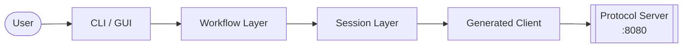

# NLI Engine

Natural-language interface engine for authoring CARP study protocols.

## Architecture



The engine receives free-text descriptions of a study protocol, maps them to API
calls via an LLM planner, and assembles the protocol on a running authoring server.

**Key principle:** `session_id` is managed entirely by the engine — the LLM never
sees it. Every API operation is exposed as a `BoundTool` with `session_id`
pre-filled and a pydantic schema the LLM can use for structured output.

## Design docs

- [Session layer](docs/design/session_layer/session_layer.md) — how `ProtocolSession`, `ToolSpec`, and `BoundTool` fit together ([diagram](docs/design/session_layer/session_layer.puml))
- [Workflow layer](docs/design/workflow_layer/workflow_layer.md) — how `Workflow`, `Step`, `WorkflowContext`, and `WorkflowConfig` fit together ([diagram](docs/design/workflow_layer/workflow_layer.puml))

## Quick start

```bash
uv sync --all-extras
uv run pytest
```
