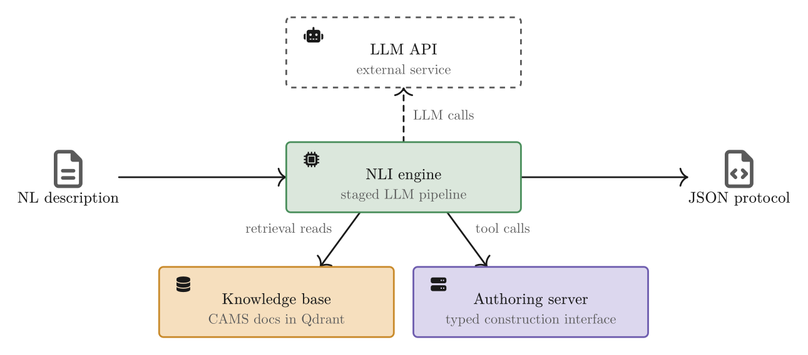
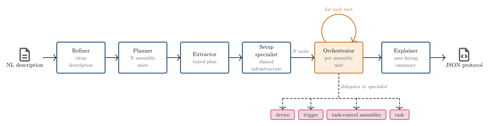
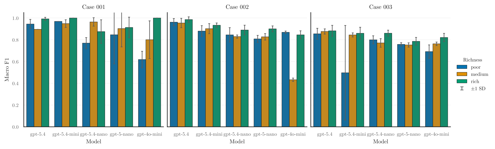

# NLI Engine

A natural-language interface that generates [CARP Mobile Sensing](https://github.com/cph-cachet/carp.sensing-flutter) (CAMS) study protocols from plain-English descriptions.

Authoring a CAMS study protocol today requires fluency in CAMS's domain model and a Dart/Flutter codebase. This engine lets a researcher describe a study in natural language and emits a valid protocol JSON by driving a running authoring server with an LLM-based pipeline.

The engine is the artefact produced by an MSc thesis at DTU (2025/2026). The published results are reproducible from this repo and the [`study-data-v1`](https://github.com/Congiuntivo/cams-nli-engine/releases/tag/study-data-v1) release.



## How it works

The engine never asks the LLM to emit a protocol as free-form JSON. Instead, it exposes every authoring-server operation as a **typed tool** with its schema and a pre-bound `session_id`, and the LLM composes the protocol by calling these tools one step at a time. Syntactic validity is guaranteed by construction; the LLM is free to focus on intent.

Generation is **staged**: the user prompt flows through a pipeline of narrow LLM-driven steps, each with its own system prompt, tool set and (optionally) retrieval over the CAMS knowledge base.



| Stage              | Role                                                                                 |
| ------------------ | ------------------------------------------------------------------------------------ |
| Refiner            | Rewrites the raw prompt into a canonical description                                 |
| Planner            | Decomposes the description into N self-contained **assembly units**                  |
| Extractor          | Emits a typed assembly plan the orchestrator can execute                             |
| Setup specialist   | Adds the shared infrastructure (smartphone, CAWS endpoint, participant role)         |
| Orchestrator       | Iterates over assembly units and delegates each sub-operation to a domain specialist |
| Domain specialists | Device, trigger, task, task-control (one LLM each, with a narrow tool set)           |
| Explainer          | Produces a user-facing summary of what was built                                     |

See [`docs/design/`](docs/design/) for a per-layer breakdown.

## Install

Python 3.10 (pinned via `.python-version`). Dependency manager: [`uv`](https://docs.astral.sh/uv/).

```bash
uv sync --extra cli
```

Set up environment variables (see [`.env.example`](.env.example)):

```bash
cp .env.example .env
# edit .env and fill in OPENAI_API_KEY, FASTEMBED_CACHE_PATH, QDRANT_URL
```

The engine also needs:

- A running [**CAMS authoring server**](https://github.com/Congiuntivo/cams-authoring-server) reachable at `http://localhost:8080` (or pass `--server URL`). It is the typed construction interface the pipeline drives.
- A Qdrant instance for retrieval if you use the `one_shot_llm` workflow. The indexed collection is built by the [**cams-kb**](https://github.com/Congiuntivo/cams-kb) pipeline over the CAMS documentation.

First-time Qdrant setup (caches FastEmbed models locally):

```bash
uv run python scripts/download_models.py
```

## Use

### Interactive

```bash
uv run nli-engine
```

### Fully automated

```bash
uv run nli-engine \
  --workflow one_shot_llm \
  --name "my-study" \
  --prompt "record steps with the smartphone and heartbeat every hour" \
  --config config.yaml \
  --log-output logs/
```

### Browser GUI

```bash
uv sync --extra gui
uv run nli-engine-gui
```

### CLI flags

| Flag                | Default                 | Description                                                            |
| ------------------- | ----------------------- | ---------------------------------------------------------------------- |
| `-w, --workflow ID` |                         | Workflow to run (see below). Skips the interactive workflow picker     |
| `-n, --name NAME`   |                         | Protocol name; skips the interactive name prompt                       |
| `-p, --prompt TEXT` |                         | Fire the first turn automatically; best combined with `-w` and `-n`    |
| `-c, --config PATH` |                         | Path to a workflow YAML config file                                    |
| `-s, --server URL`  | `http://localhost:8080` | Authoring server base URL                                              |
| `-lo, --log-output` |                         | Write a JSON Lines session log (file path or directory for autoname)   |
| `--stop-after STEP` |                         | Stop after `refiner`, `planner`, `extractor` or `orchestrator` (debug) |
| `-v`, `-vv`         |                         | `-v` one-line trace per event, `-vv` full debug blocks                 |

### Workflow config

```yaml
# config.yaml
models:
  default: "gpt-5.4-mini" # LiteLLM routing: provider/model
  # orchestrator: "gpt-4o"       # override individual steps if needed
parameters:
  api_base: "http://localhost:11434" # required for Ollama; omit for cloud providers
temperature:
  default: 0.3
retrieval:
  dense_model: "ollama/mahonzhan/all-MiniLM-L6-v2"
  sparse_model: "Qdrant/bm25"
  multi_model: "colbert-ir/colbertv2.0"
  method: "hybrid"
  rerank: true
  top_k: 5
```

Model identifiers follow [LiteLLM's routing conventions](https://docs.litellm.ai/docs/providers).

### Available workflows

| ID             | What it does                                                                                 |
| -------------- | -------------------------------------------------------------------------------------------- |
| `dummy`        | Deterministic baseline: hard-codes the three setup tool calls, no LLM                        |
| `dummy_llm`    | LLM-driven version of the above; same calls, autonomous                                      |
| `one_shot_llm` | Full staged pipeline (refiner → planner → extractor → setup → orchestrator with specialists) |

## Evaluation

`nli-eval` reads session logs (`--log-output`) and reports protocol-level metrics (HashMatch F1 over the field structure of the CAMS protocol) plus execution metrics (tokens, cost, wall time, tool-call failures).

### Evaluate a single run

```bash
uv run nli-eval run run.jsonl
uv run nli-eval run run.jsonl --output metrics.json
```

### Evaluate a dataset

The dataset is described by a YAML manifest that pairs **cases** (each with an expected protocol) and **prompts** (each a description of that case at varying richness):

```yaml
# dataset/manifest.yaml
cases:
  - id: "001_diary_study"
    expected: cases/001_expected.json
    prompts:
      v1: "record steps with the smartphone, heartbeat every hour"
      detailed: "record steps and location every hour, collect participant name at enrolment"
```

Evaluate one case:

```bash
uv run nli-eval dataset dataset/manifest.yaml logs/run1.jsonl
```

Batch over a logs directory (picks the most recent log matching each prompt):

```bash
uv run nli-eval dataset dataset/manifest.yaml --last-from logs/ --output results.json
```

### Inspect the output

```bash
uv run nli-eval extract run.jsonl protocol.json           # final protocol from a log
uv run nli-eval canonicalize protocol.json --output c.json # content-addressed form (internal diff format)
```

See the [eval design doc](docs/design/eval/eval.md) for the full metric reference.

## Results

The thesis evaluates the pipeline on a 3-scenario × 3-prompt-richness matrix across five OpenAI models and compares against a ReAct baseline and human-expert protocols. Macro F1 by model and prompt richness, faceted by case:



Raw per-run JSONL logs and preprocessed CSVs are packaged in release [`study-data-v1`](https://github.com/Congiuntivo/cams-nli-engine/releases/tag/study-data-v1). To unpack:

```bash
# From the repo root, so paths line up with the working tree:
curl -L -o nli_engine-study-results.tar.zst \
  https://github.com/Congiuntivo/cams-nli-engine/releases/download/study-data-v1/nli_engine-study-results.tar.zst
sha256sum -c <<<"9f1e06aeceb6bf7039c35e8d85cd51c7fb3496e6918825b959544099ab32d2bc  nli_engine-study-results.tar.zst"
tar --zstd -xf nli_engine-study-results.tar.zst
rm nli_engine-study-results.tar.zst
```

See [`study/runs/README.md`](study/runs/README.md) for the archive layout and how to regenerate everything from scratch.

## Related repos

- [**cams-authoring-server**](https://github.com/Congiuntivo/cams-authoring-server): the stateful HTTP authoring API this engine drives. Every typed tool here maps to one of its endpoints.
- [**cams-kb**](https://github.com/Congiuntivo/cams-kb): ingestion and retrieval pipeline over the CAMS documentation; produces the Qdrant collection used by the `one_shot_llm` workflow's RAG step.

## Design docs

- [Session layer](docs/design/session_layer/session_layer.md): `ProtocolSession`, `ToolSpec`, `BoundTool`
- [Workflow layer](docs/design/workflow_layer/workflow_layer.md): `Workflow`, `Step`, `WorkflowContext`, `TurnResult`, `Conversation`
- [LLM layer](docs/design/llm_layer/llm_layer.md): `LLMClient`, `LLMStep`, schema conversion, tool dispatch
- [Retrieval layer](docs/design/retrieval_layer/retrieval_layer.md): `Retriever`, `Document`, `RetrievedChunk`; backends: `KeywordRetriever`, `QdrantRetriever` (hybrid dense+sparse+ColBERT)
- [CLI](docs/design/cli/cli.md): argument structure, interactive flow, session logging
- [Eval](docs/design/eval/eval.md): `nli-eval` CLI, JSONL parsing, metrics, dataset manifest, HashMatch

## Development

```bash
uv sync --all-extras
uv run pytest
uv run pre-commit install --install-hooks
```

### Regenerate the API client

The generated client under `src/nli_engine/client/_generated/` is produced from `openapi/openapi.yaml`. It is committed so CI and fresh clones work without Java; regenerate after changing the spec:

```bash
bash openapi/generate_client.sh
```

## License

See [LICENSE](LICENSE).
