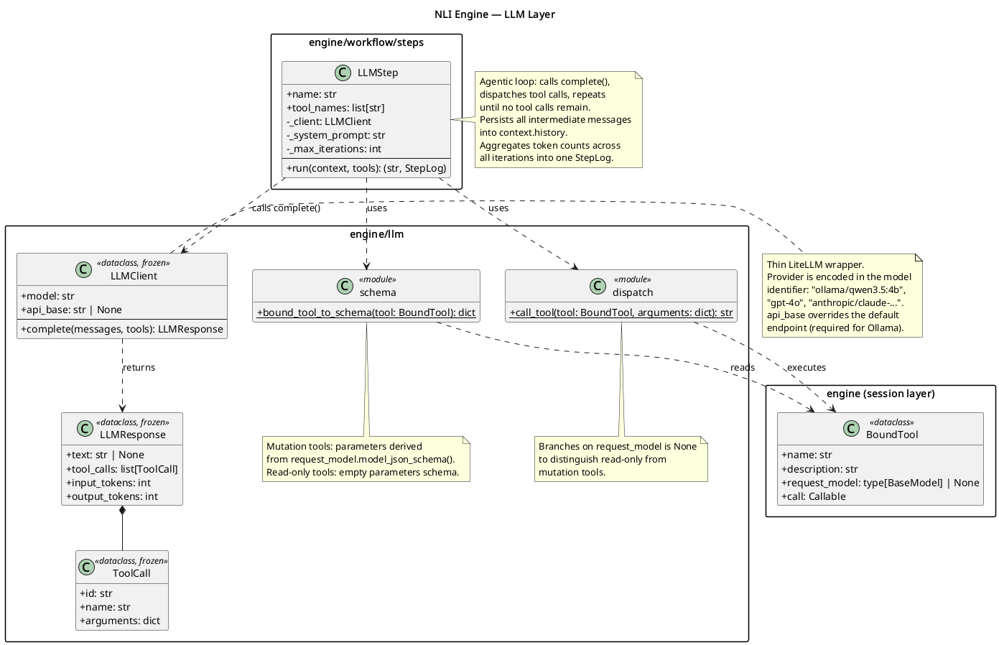

# LLM layer



## Concept

The LLM layer is the transport and protocol-translation bridge between the workflow layer and LLM APIs. It is intentionally thin and has **no dependency on the workflow layer** — workflow constructs (`Message`, `WorkflowContext`) are the concern of `LLMStep`, which sits one layer above.

Its three responsibilities are:

- **Transport** — `LLMClient` wraps LiteLLM's `completion()` and returns typed value objects; callers never touch raw provider responses.
- **Schema conversion** — `bound_tool_to_schema` converts `BoundTool` definitions into OpenAI function-calling schemas accepted by any LiteLLM-compatible provider.
- **Tool dispatch** — `call_tool` executes a `BoundTool` from the structured arguments returned by the LLM.

```
WorkflowContext (history) ──▶ LLMStep ──▶ LLMClient.complete() ──▶ LiteLLM ──▶ Provider
                                    │                │
                             bound_tool_to_schema   call_tool
                                    │                │
                               BoundTool ◀───────────┘
```

## Components

### `engine/llm/client.py`

**`LLMClient`** is a frozen dataclass that holds the model identifier and an optional API base URL.

| field      | type          | meaning                                                                                     |
| ---------- | ------------- | ------------------------------------------------------------------------------------------- |
| `model`    | `str`         | LiteLLM model identifier, e.g. `"ollama/qwen3.5:4b"`, `"gpt-4o"`, `"anthropic/claude-..."`  |
| `api_base` | `str \| None` | Custom API endpoint (e.g. Ollama at `http://localhost:11434`); `None` uses provider default |

**`LLMResponse`** is the typed return value of `complete()`.

| field           | type             | meaning                                                        |
| --------------- | ---------------- | -------------------------------------------------------------- |
| `text`          | `str \| None`    | LLM text output; `None` when the response is only tool calls   |
| `tool_calls`    | `list[ToolCall]` | parsed tool invocations; empty list when the LLM produced text |
| `input_tokens`  | `int`            | prompt token count                                             |
| `output_tokens` | `int`            | completion token count                                         |

**`ToolCall`** is one parsed tool invocation.

| field       | type   | meaning                                                            |
| ----------- | ------ | ------------------------------------------------------------------ |
| `id`        | `str`  | opaque call identifier used to match tool results back to calls    |
| `name`      | `str`  | function name; matches a `BoundTool.name` in the tool map          |
| `arguments` | `dict` | decoded JSON arguments ready to pass to the tool's `request_model` |

### `engine/llm/schema.py`

```python
def bound_tool_to_schema(tool: BoundTool) -> dict:
```

Converts one `BoundTool` to an OpenAI-format tool schema dict. For mutation tools the `parameters` object is derived from `request_model.model_json_schema()`. Read-only tools (no `request_model`) receive an empty parameters schema so the LLM can still invoke them by name.

### `engine/llm/dispatch.py`

```python
def call_tool(tool: BoundTool, arguments: dict) -> str:
```

Executes a `BoundTool` from the LLM-returned arguments dict and returns the result serialised to a string for inclusion in the tool-result message. Branches on `request_model is None` to distinguish read-only from mutation tools.

## Integration: `LLMStep`

`LLMStep` (in `engine/workflow/steps/llm.py`) is the only consumer of this layer from the workflow side. It runs the agentic loop:

1. Converts `context.history` to message dicts and prepends the system prompt.
2. Calls `LLMClient.complete()` repeatedly until the LLM stops issuing tool calls.
3. Dispatches each tool call via `call_tool`.
4. Persists all intermediate messages (assistant-with-tool-calls + tool results) back into `context.history`.
5. Returns `(final_text, StepLog)` with aggregated token counts.

See the [workflow layer design](../workflow_layer/workflow_layer.md) for how `LLMStep` fits into the broader orchestration.

## Configuration

`LLMClient` is constructed by the workflow from `WorkflowConfig`. A minimal YAML for a local Ollama instance:

```yaml
models:
  planner: "ollama/qwen3.5:4b"
parameters:
  api_base: "http://localhost:11434"
```

Model identifiers follow LiteLLM's routing conventions: `ollama/<model>` for Ollama, bare names for OpenAI (`gpt-4o`), `anthropic/<model>` for Anthropic, etc.

The `llm` package requires the optional `llm` extra:

```bash
uv sync --extra llm
```
