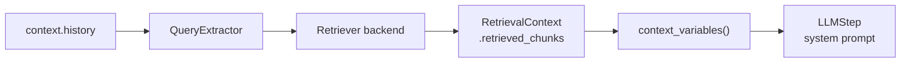

# Retrieval layer

## Concept

The retrieval layer provides a pluggable knowledge-retrieval mechanism that any workflow can use at any step position — before the planner, before a specialist, or anywhere else. It is backend-agnostic: keyword search, vector search, and hybrid strategies all satisfy the same `Retriever` interface.

Its responsibilities are:

- **Query extraction** — derive a focused search query from the current `WorkflowContext` (by default: the last user message).
- **Retrieval** — fetch the most relevant `Document` entries from a corpus via a swappable `Retriever` backend.
- **Context injection** — store results in `RetrievalContext.retrieved_chunks` and expose them as the `{{var: retrieved_context}}` template variable, which any downstream `LLMStep` can inject into its system prompt.

```
WorkflowContext.history
    ──▶ QueryExtractor.extract()
    ──▶ query: str
    ──▶ Retriever.retrieve()
    ──▶ list[RetrievedChunk]
    ──▶ RetrievalContext.retrieved_chunks
    ──▶ context_variables() → {"retrieved_context": "…"}
    ──▶ LLMStep._render_system_prompt()
    ──▶ rendered system prompt sent to LLM
```



## Components

### `engine/retrieval/document.py`

`Document` represents one entry in the retrieval corpus. It is the input type for every `Retriever` backend.

| field     | type  | meaning                                                                   |
| --------- | ----- | ------------------------------------------------------------------------- |
| `source`  | `str` | identifier used to populate `RetrievedChunk.source`; appears in eval logs |
| `content` | `str` | searchable text                                                           |

### `engine/retrieval/chunk.py`

`RetrievedChunk` is a frozen dataclass — the output type of every `Retriever.retrieve()` call.

| field     | type    | meaning                                               |
| --------- | ------- | ----------------------------------------------------- |
| `content` | `str`   | text of the matched document                          |
| `score`   | `float` | relevance score; higher is more relevant              |
| `source`  | `str`   | identifier of the originating `Document`; for tracing |

### `engine/retrieval/retriever.py`

`Retriever` is the ABC that all backends implement. A single abstract method:

```python
def retrieve(self, query: str, top_k: int = 5) -> list[RetrievedChunk]: ...
```

Returns up to `top_k` chunks ordered by descending score. Returns an empty list when nothing matches.

### `engine/retrieval/query.py`

**`QueryExtractor`** is a `Protocol` (structural typing). Any class with a compatible `extract` method satisfies it without subclassing — this keeps LLM-based extractors decoupled from the default implementation.

```python
def extract(self, context: WorkflowContext) -> str: ...
```

**`LastUserMessageExtractor`** — the default implementation. Returns the content of the most recent user-role message in `context.history`, or `""` if history is empty. Pass a custom extractor to `RetrievalStep` when the query should be generated differently (e.g. by an LLM sub-call).

### `engine/retrieval/context.py`

`RetrievalContext(WorkflowContext)` is an intermediate base class. Workflows that use a `RetrievalStep` inherit from it instead of `WorkflowContext` directly.

| field              | type                   | meaning                                                  |
| ------------------ | ---------------------- | -------------------------------------------------------- |
| `retrieved_chunks` | `list[RetrievedChunk]` | populated by `RetrievalStep`; empty until retrieval runs |

`context_variables()` override exposes the chunks as the `retrieved_context` template variable:

- Empty list → `{"retrieved_context": ""}` (the tag renders to an empty string, so the prompt stays valid even when retrieval found nothing).
- Non-empty → each chunk formatted as `[{source}] (score: {score:.2f})\n{content}`, joined by blank lines.

### `engine/retrieval/backends/keyword.py`

`KeywordRetriever(Retriever)` — in-memory keyword backend. No external dependencies; suitable for small, static corpora and for testing retrieval pipelines without a vector store.

**Scoring:** for each unique lowercased query token, checks whether it appears anywhere in the document text (case-insensitive substring match). Score = `hits / len(query_tokens)`, so it represents the fraction of distinct query terms covered.

| constructor arg | type             | meaning                  |
| --------------- | ---------------- | ------------------------ |
| `corpus`        | `list[Document]` | documents to search over |

## Integration: `RetrievalStep`

`RetrievalStep` (in `engine/workflow/steps/retrieval.py`) is the `Step` subclass that wires the retrieval domain into a workflow. It calls no LLM and has no declared tools.

| constructor arg   | type                     | meaning                                            |
| ----------------- | ------------------------ | -------------------------------------------------- |
| `name`            | `str`                    | step name; appears in `StepLog`                    |
| `retriever`       | `Retriever`              | backend to query                                   |
| `query_extractor` | `QueryExtractor \| None` | defaults to `LastUserMessageExtractor` when `None` |
| `top_k`           | `int`                    | maximum chunks to retrieve (default: 5)            |

`_run()` enforces that `context` is a `RetrievalContext` (raises `TypeError` immediately if not), then:

1. Calls `query_extractor.extract(context)` to get the query.
2. Calls `retriever.retrieve(query, top_k)` to get the chunks.
3. Writes them to `context.retrieved_chunks`.
4. Returns `(chunks, StepLog)` with `extra={"query": ..., "n_chunks": ...}`.

## System prompt injection

`LLMStep._render_system_prompt(context)` resolves `{{var: name}}` tags at call time using `context.context_variables()`. This is distinct from `{{inject: Name}}` tags, which are resolved once at file-load time from static markdown fragments.

To inject retrieved context into a step's system prompt, add the tag anywhere in the prompt template:

```markdown
## Relevant knowledge

{{var: retrieved_context}}

---

You are a planner…
```

`ValueError` is raised at call time if the tag references a variable not present in `context_variables()` — this catches misconfiguration before any LLM call fires.

## Wiring retrieval into a workflow

```python
class MyWorkflowContext(RetrievalContext):
    pass  # add more fields if needed

class MyWorkflow(Workflow[MyWorkflowContext]):
    def __init__(self, config: WorkflowConfig, session: ProtocolSession) -> None:
        super().__init__(config, session)
        corpus = [Document(source="api-docs", content="...")]
        self._retrieval_step = RetrievalStep(
            name="retrieval",
            retriever=KeywordRetriever(corpus),
        )
        self._planner_step = LLMStep(
            name="planner",
            client=LLMClient(model=config.models["planner"]),
            system_prompt=load_prompt("nli_engine.engine.prompts.my_workflow", "planner.md"),
        )

    def run_turn(self, user_input: str, context: MyWorkflowContext) -> TurnResult:
        context.history.append(Message(role="user", content=user_input))
        self._retrieval_step.run(context)   # populates context.retrieved_chunks
        text, log = self._planner_step.run(context)  # {{var: retrieved_context}} resolved here
        return TurnResult(message=text, logs=[log], done=True)
```

## Adding a new backend

Implement `Retriever` and place the file under `engine/retrieval/backends/`:

```python
class VectorRetriever(Retriever):
    def __init__(self, index: ...) -> None: ...

    def retrieve(self, query: str, top_k: int = 5) -> list[RetrievedChunk]:
        ...
```

No changes to `RetrievalStep`, `RetrievalContext`, or any workflow are required.
