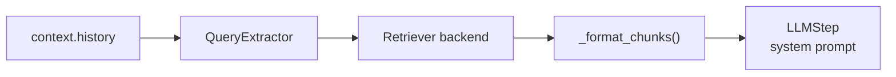

# Retrieval layer

## Concept

The retrieval layer provides a pluggable knowledge-retrieval mechanism that any `LLMStep`
can opt into. Retrieval is **local to the step**: pass a `Retriever` (and optionally a
`QueryExtractor` and `top_k`) when constructing an `LLMStep`, and the step runs retrieval
immediately before each LLM call, formats the results, and injects them into its system
prompt via `{{var: retrieved_context}}`. No shared context state is read or written.

This design makes retrieval composable at step granularity. The orchestrator, the planner,
or any individual specialist can each carry their own retriever and generate their own
focused query — independently, without any coupling between them.

```
context.history
    ──▶ QueryExtractor.extract()
    ──▶ query: str
    ──▶ Retriever.retrieve(query, top_k)
    ──▶ list[RetrievedChunk]
    ──▶ _format_chunks()   →   "<context>\n<document …>…</document>\n</context>"
    ──▶ LLMStep._render_system_prompt()   →   {{var: retrieved_context}} substituted
    ──▶ rendered system prompt sent to LLM
```



## Components

### `engine/retrieval/document.py`

`Document` represents one entry in the retrieval corpus. It is the input type for every
`Retriever` backend.

| field     | type  | meaning                                                                   |
| --------- | ----- | ------------------------------------------------------------------------- |
| `source`  | `str` | identifier used to populate `RetrievedChunk.source`; appears in eval logs |
| `content` | `str` | searchable text                                                           |

### `engine/retrieval/chunk.py`

`RetrievedChunk` is a frozen dataclass — the output type of every `Retriever.retrieve()` call.

| field     | type    | meaning                                               |
| --------- | ------- | ----------------------------------------------------- |
| `content` | `str`   | text of the matched document                          |
| `score`   | `float` | relevance score; higher is more relevant              |
| `source`  | `str`   | identifier of the originating `Document`; for tracing |

### `engine/retrieval/retriever.py`

`Retriever` is the ABC that all backends implement. A single abstract method:

```python
def retrieve(self, query: str, top_k: int = 5) -> list[RetrievedChunk]: ...
```

Returns up to `top_k` chunks ordered by descending score. Returns an empty list when
nothing matches.

### `engine/retrieval/query.py`

**`QueryExtractor`** is a `Protocol` (structural typing). Any class with a compatible
`extract` method satisfies it without subclassing — this keeps LLM-based extractors
decoupled from the default implementation.

```python
def extract(self, context: WorkflowContext) -> str: ...
```

**`LastUserMessageExtractor`** — the default implementation. Returns the content of the
most recent user-role message in `context.history`, or `""` if history is empty. Pass a
custom extractor to `LLMStep` when the query should be generated differently (e.g. a
domain-specific reformulation or a preliminary LLM sub-call).

### `engine/retrieval/backends/keyword.py`

`KeywordRetriever(Retriever)` — in-memory keyword backend. No external dependencies;
suitable for small, static corpora and for testing retrieval pipelines without a vector
store.

**Scoring:** for each unique lowercased query token, checks whether it appears anywhere in
the document text (case-insensitive substring match). Score = `hits / len(query_tokens)`,
representing the fraction of distinct query terms covered.

| constructor arg | type             | meaning                  |
| --------------- | ---------------- | ------------------------ |
| `corpus`        | `list[Document]` | documents to search over |

### `engine/retrieval/backends/qdrant.py`

`QdrantRetriever(Retriever)` — production backend backed by a Qdrant vector store.
Supports three search strategies selected by `method`:

| `method`   | what happens                                                                                       |
| ---------- | -------------------------------------------------------------------------------------------------- |
| `"dense"`  | Single-vector ANN search using dense embeddings (LiteLLM model)                                    |
| `"sparse"` | Sparse BM25 search using FastEmbed                                                                 |
| `"hybrid"` | Prefetch candidates from both dense and sparse branches, then fuse with RRF or rerank with ColBERT |

When `method="hybrid"` and `rerank=True`, a ColBERT late-interaction model rescores the
prefetched candidates. Set `rerank=False` to use reciprocal-rank fusion (RRF) instead.
`rerank=True` is invalid when `method` is not `"hybrid"` and raises a `ValueError` at
config-parse time.

**Configuration split:**

| parameter              | source        | notes                                               |
| ---------------------- | ------------- | --------------------------------------------------- |
| `QDRANT_URL`           | `.env`        | e.g. `http://localhost:6333` (required)             |
| `QDRANT_COLLECTION`    | `.env`        | collection name built by the kb pipeline (required) |
| `FASTEMBED_CACHE_PATH` | `.env`        | path to pre-downloaded FastEmbed models (optional)  |
| `OPENAI_API_BASE`      | `.env`        | override LiteLLM endpoint when needed (optional)    |
| `dense_model`          | `config.yaml` | LiteLLM string; must match index-time model         |
| `sparse_model`         | `config.yaml` | FastEmbed model name; must match index time         |
| `multi_model`          | `config.yaml` | FastEmbed model name; must match index time         |
| `method`               | `config.yaml` | `"hybrid"` \| `"dense"` \| `"sparse"`               |
| `rerank`               | `config.yaml` | ColBERT reranking on top of hybrid prefetch         |
| `prefetch_limit`       | `config.yaml` | candidates per branch before fusion/reranking       |
| `top_k`                | `config.yaml` | final number of results returned                    |

**One-time model download:**

FastEmbed models must be downloaded before the first use. Run once per environment:

```bash
uv run python scripts/download_models.py
```

Reads `FASTEMBED_CACHE_PATH` from the environment and exits with an error if it is unset.

**Constructing the retriever:**

```python
from nli_engine.engine.retrieval.backends.qdrant import QdrantRetriever

retriever = QdrantRetriever(
    dense_model=config.retrieval.dense_model,
    sparse_model=config.retrieval.sparse_model,
    multi_model=config.retrieval.multi_model,
    method=config.retrieval.method,
    rerank=config.retrieval.rerank,
    prefetch_limit=config.retrieval.prefetch_limit,
)
```

`QDRANT_URL`, `QDRANT_COLLECTION`, and `FASTEMBED_CACHE_PATH` are read from the environment
automatically.

## Integration: wiring retrieval into an `LLMStep`

Pass a `retriever` when constructing any `LLMStep`. The step handles everything else.

| constructor arg   | type                     | meaning                                              |
| ----------------- | ------------------------ | ---------------------------------------------------- |
| `retriever`       | `Retriever \| None`      | backend to query; `None` disables retrieval entirely |
| `query_extractor` | `QueryExtractor \| None` | defaults to `LastUserMessageExtractor` when `None`   |
| `top_k`           | `int`                    | maximum chunks to retrieve (default: 5)              |

On each `_run()` call, when `retriever` is set:

1. `query_extractor.extract(context)` produces the search query.
2. `retriever.retrieve(query, top_k)` returns the ranked chunks.
3. Chunks are formatted as an Anthropic-style XML block and assigned to
   `extra_vars["retrieved_context"]`.
4. `_render_system_prompt` merges `extra_vars` on top of `context.context_variables()`,
   so `{{var: retrieved_context}}` in the prompt template is substituted.
5. `StepLog.extra` records `{"query": ..., "n_chunks": ...}` for eval and debugging.

When `retriever` is `None`, none of this runs and `StepLog.extra` is empty.

### Chunk format

Chunks are rendered in Anthropic's recommended XML format for retrieval-augmented
generation:

```xml
<context>
<document source="api-docs/devices">
The Device entity represents a connected sensor…
</document>
<document source="api-docs/triggers">
Triggers fire on schedule or on sensor events…
</document>
</context>
```

The `source` attribute comes from `RetrievedChunk.source`.

## System prompt injection

Add `{{var: retrieved_context}}` anywhere in the step's system prompt template:

```markdown
## Relevant knowledge

{{var: retrieved_context}}

---

You are a planner…
```

`ValueError` is raised at call time if the tag references a variable not present — this
catches misconfiguration (e.g. using the tag without passing a `retriever`) before any LLM
call fires.

## Example: specialist with its own retriever

Because retrieval is local to each step, a specialist can carry a retriever tuned to its
domain without affecting any other step:

```python
device_step = LLMStep(
    name="device_specialist",
    client=LLMClient(model=config.models["device"]),
    system_prompt=load_prompt("nli_engine.engine.prompts.one_shot.specialists", "device.md"),
    tool_names=DEVICE_SPECIALIST_TOOL_NAMES,
    retriever=KeywordRetriever(device_corpus),
    query_extractor=DeviceQueryExtractor(),  # custom, domain-specific
    top_k=3,
)
```

The specialist generates its own query from the delegation instruction it received and
retrieves device-specific documentation independently of what the orchestrator retrieved.

## Adding a new backend

Implement `Retriever` and place the file under `engine/retrieval/backends/`:

```python
class VectorRetriever(Retriever):
    def __init__(self, index: ...) -> None: ...

    def retrieve(self, query: str, top_k: int = 5) -> list[RetrievedChunk]:
        ...
```

No changes to any workflow, step, or context class are required.
