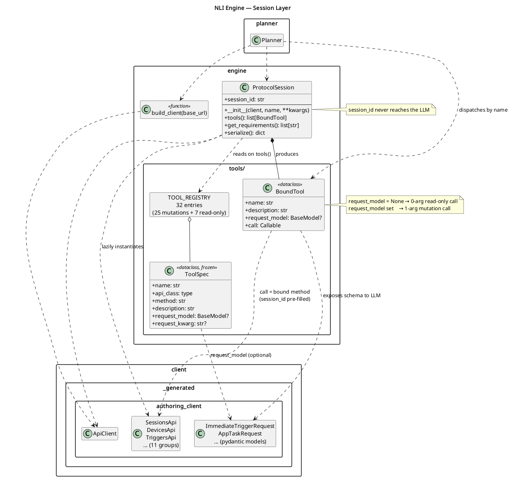

# Session layer



## Concept

The session layer sits between the LLM planner and the generated API client. Its job is to:

- Own a single authoring session (`session_id` is created on construction and never exposed to the LLM).
- Expose every API operation as a **bound tool**: a callable with `session_id` pre-filled and a pydantic schema the LLM can use for structured output.
- Keep client transport configuration entirely separate.

```
Planner ──▶ ProtocolSession.tools() ──▶ BoundTool.call(request) ──▶ Generated Client ──▶ Server
```

## Components

### `engine/client.py`

Single function `build_client(base_url) -> ApiClient`. The only place that touches `Configuration`.

### `engine/tools/`

Pure data — no runtime behaviour.

| file          | content                                                                      |
| ------------- | ---------------------------------------------------------------------------- |
| `spec.py`     | `ToolSpec` (frozen dataclass) and `BoundTool` dataclass                      |
| `models.py`   | Local pydantic models for API operations that lack a generated request class |
| `registry.py` | `TOOL_REGISTRY: list[ToolSpec]` — 32 entries (25 mutations + 7 read-only)    |

**ToolSpec** declares: API class, method name, description, and optionally a pydantic `request_model`.  
**BoundTool** is what the planner holds: a name, schema (`request_model`), and a zero- or one-arg `call`.

### `engine/session.py`

`ProtocolSession` is the only stateful object.

- `__init__` calls `create_protocol_session` and stores `session_id`.
- `tools()` iterates `TOOL_REGISTRY` and returns `BoundTool` instances with `session_id` bound.
- `get_requirements()` and `serialize()` are direct methods for programmatic use by the planner loop.

`_bind` produces exactly two call signatures:

| condition               | `call` signature                          |
| ----------------------- | ----------------------------------------- |
| `request_model is None` | `call()` — read-only, no input            |
| `request_model is set`  | `call(req)` — takes one pydantic instance |

How `req` is forwarded to the underlying generated method is an internal detail of `_bind` (auto-detected via signature introspection).

## Planner usage

```python
session = ProtocolSession(build_client(), name="My Study")
tools   = {t.name: t for t in session.tools()}

# Expose schemas to the LLM (mutation tools only)
schemas = {name: t.request_model.model_json_schema()
           for name, t in tools.items() if t.request_model}

# Dispatch a mutation call
tool = tools["add_immediate_trigger"]
tool.call(tool.request_model(trigger_name="start"))

# Dispatch a read-only call
requirements = tools["get_requirements"].call()
```
