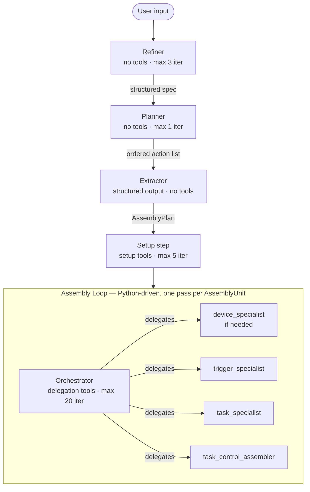
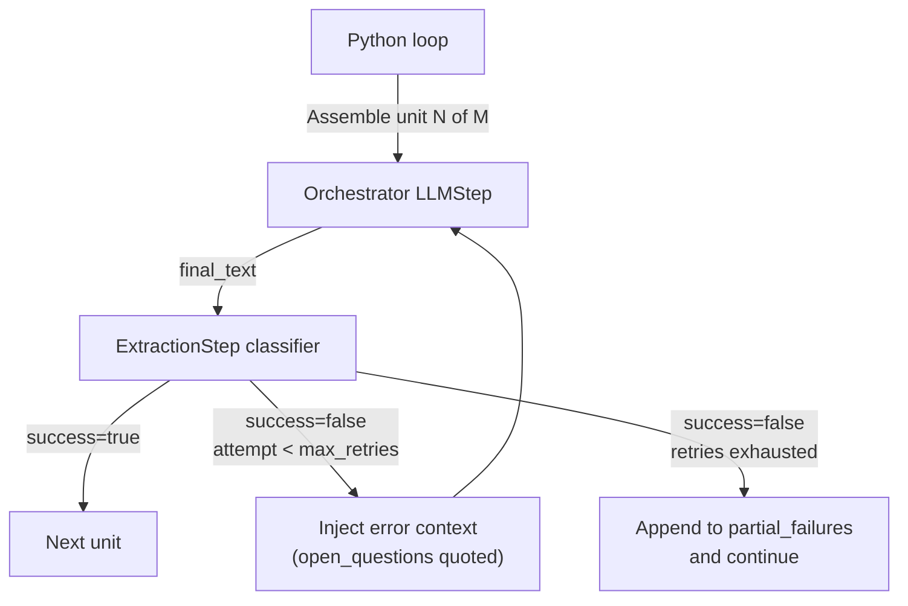
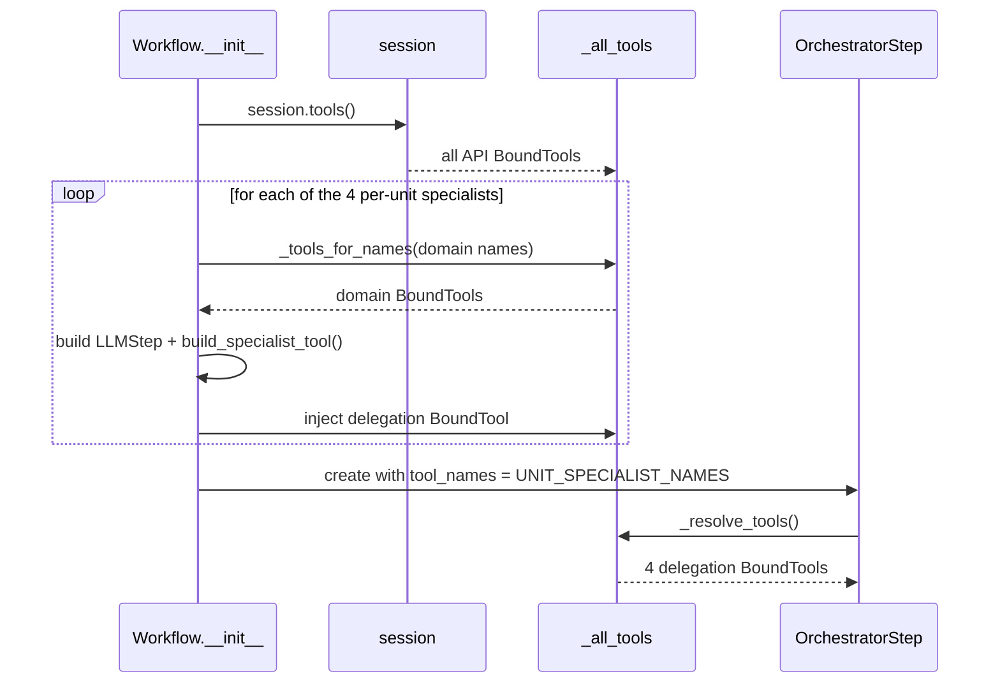

# One-Shot LLM Workflow

`OneShotLLMWorkflow` is the production workflow for protocol authoring. It takes a
single free-text user request and assembles a complete CARP study protocol in one
turn, using a five-step pipeline: a **refiner**, a **planner**, an **extractor**, a
**setup step**, and a per-unit **orchestrator** backed by four domain specialists.

## Pipeline overview



All main steps share `OneShotLLMWorkflowContext.history`. The extractor reads but
never writes to the shared history. Specialist invocations run in isolated
`SpecialistContext` instances and do not touch the main history.

## Steps

### Refiner

Rewrites the user's free-text into a formal, structured specification. Runs without
tools; uses the `refiner.md` system prompt. The output is appended to the shared
history so the planner and extractor read a clean, unambiguous description rather
than the raw user message.

### Planner

Reads the refined specification and produces a concise ordered list of domain objects
to create — one item per line, in plain language. Runs in a single iteration without
tools. Its output is the input to the extractor.

### Extractor

Parses the planner's output into a structured `AssemblyPlan` using
`LLMClient.complete_structured()`. It receives only the planner's final reply (not the
full history) and the `assembly_plan_extraction.md` system prompt. It never writes
messages back to the shared history — the step is invisible to all subsequent steps.

The result is an `AssemblyPlan` containing an ordered list of `AssemblyUnit` objects,
each with a `name`, a self-contained `description`, and a `needs_connected_device`
flag Python uses to log intent.

### Setup step

Runs the `setup_specialist` prompt as a direct `LLMStep` against the shared context,
creating the shared protocol infrastructure (data endpoint, participant roles, primary
devices). Its tool-call exchanges are appended to the shared history so every
subsequent orchestrator invocation can see what already exists.

### Orchestrator

Python iterates over `AssemblyPlan.units` and invokes the orchestrator once per unit,
injecting a user message of the form `"Assemble assembly unit N of M: <description>"`.
The orchestrator does not call API tools directly; its tool set consists of the four
per-unit delegation tools.

**Per-unit assembly order:**

1. `device_specialist` — create the connected device or service, if any. Skip if the
   unit needs no connected device.
2. `trigger_specialist` — create the trigger.
3. `task_specialist` — create the task.
4. `task_control_assembler` — bind trigger, task, and device into the TaskControl.

After `task_control_assembler` returns, the orchestrator emits a plain-text summary
of the entities created for that unit, together with any Assumptions or Open questions.
All orchestrator invocations share the same context, so AU N+1 sees AU N's history.

**Retry loop.** After each orchestrator invocation, a lightweight
`ExtractionStep[OrchestratorResult]` classifies the summary text as `success=true`
or `success=false` (with `open_questions`). This step runs in a throwaway context and
never touches the shared history. On failure, a retry user message quoting the open
questions is appended and the orchestrator is re-invoked, up to `max_unit_retries`
times (default 1). Units that still fail after all retries are recorded in
`TurnResult.partial_failures` as human-readable strings and the loop continues to the
next unit.



## Specialists

Each per-unit specialist is an `LLMStep` wrapped as a `BoundTool` via
`build_specialist_tool()` in `engine/workflow/specialist.py`. The orchestrator calls
them with a single `DelegationRequest(instruction: str)` argument — a natural-language
description containing all names and parameters the specialist needs.

The setup step is **not** a delegation tool; it runs as a plain `LLMStep` directly
against the shared context (see [Setup step](#setup-step) above).

### Isolation model

Specialists run in fresh `SpecialistContext` instances containing only the delegation
instruction as the first user message. They have no access to the main conversation
history. To discover existing protocol state they use read-only API tools
(`get_triggers`, `get_tasks`, etc.) before making any mutation call — making each
specialist **idempotent**: calling it a second time for the same entity is safe.

### Tool subsets

Each specialist is given only the `BoundTool`s relevant to its domain. The subsets are
defined as named lists in `engine/tools/registry.py`.

| Step / Specialist        | Domain                                            | API tools                                                                                                                                        |
| ------------------------ | ------------------------------------------------- | ------------------------------------------------------------------------------------------------------------------------------------------------ |
| Setup step (direct)      | Data endpoint, participant roles, primary devices | `add_data_endpoint`, `add_participant_role`, `get_participant_roles`, `add_primary_smartphone`, `add_primary_web_browser`, `get_primary_devices` |
| `device_specialist`      | Connected devices and services                    | `add_esense/movesense/movisens/polar`, `get_connected_devices`, `add_*_service`                                                                  |
| `trigger_specialist`     | All trigger types                                 | `add_immediate/delayed/periodic/cron/manual/no_op_trigger`, `get_triggers`                                                                       |
| `task_specialist`        | All task types                                    | `add_background/app/health_app/web_task`, `get_tasks`                                                                                            |
| `task_control_assembler` | TaskControl binding                               | `add_task_control`, `get_task_controls`, plus cross-domain reads                                                                                 |

The `task_control_assembler` also receives read-only access to triggers, tasks, and
devices so it can verify that all referenced entities exist before creating the binding.

### Delegation tool wiring



Adding delegation tools to `self._all_tools` lets `_resolve_tools()` work unchanged for
the orchestrator step.

## Configuration

`WorkflowConfig` keys consumed by this workflow:

| models key       | step                                              |
| ---------------- | ------------------------------------------------- |
| `"default"`      | Fallback for any step without an explicit key     |
| `"refiner"`      | Refiner step                                      |
| `"planner"`      | Planner step                                      |
| `"extractor"`    | Extractor step                                    |
| `"orchestrator"` | Orchestrator step                                 |
| `"specialist"`   | Setup step and all four per-unit specialist steps |

Each step falls back to `models["default"]` if its specific key is absent.

```yaml
models:
  default: "gpt-5.4-mini"
  # override individual steps as needed:
  # orchestrator: "gpt-5.4"
parameters:
  api_base: "https://api.openai.com/v1/"
  max_unit_retries: 1 # retries per assembly unit on failure (default 1)
max_iterations:
  orchestrator: 20
  # specialist steps default to 5 each; override individually if needed:
  # trigger_specialist: 8
```

`max_iterations` keys for specialist steps (`setup_specialist`, `device_specialist`,
`trigger_specialist`, `task_specialist`, `task_control_assembler`) default to 5 each.

## Context and history

`OneShotLLMWorkflowContext` holds a single `history: list[Message]` (inherited from
`WorkflowContext`). The refiner, planner, setup, and orchestrator steps all share and
append to this list. The extractor is invisible to it: it reads only the planner's
last reply and never writes back. Specialist invocations also do not touch the main
history — they run in isolated `SpecialistContext` instances.

```mermaid
sequenceDiagram
    participant H as context.history
    participant R as Refiner
    participant P as Planner
    participant E as Extractor
    participant S as Setup step
    participant O as Orchestrator

    Note over H: user message appended before steps run
    R->>H: assistant reply (structured spec)
    P->>H: assistant reply (ordered action list)
    Note over E: reads planner reply only; never writes to H
    S->>H: tool calls + tool results + assistant reply
    loop per AssemblyUnit (Python-driven)
        Note over H: user message injected: "Assemble unit N of M: ..."
        O->>H: tool call — device_specialist(instruction) [if needed]
        H->>O: tool result — specialist summary text
        O->>H: tool call — trigger_specialist(instruction)
        H->>O: tool result — specialist summary text
        O->>H: tool call — task_specialist(instruction)
        H->>O: tool result — specialist summary text
        O->>H: tool call — task_control_assembler(instruction)
        H->>O: tool result — specialist summary text
        O->>H: final assistant reply for this unit
    end
```

The orchestrator's tool-call messages record the delegation instruction and the
specialist's summary reply — providing full observability of the Assembly Loop in the
main history without embedding specialist-internal tool exchanges. Because all
orchestrator invocations share the same context, each unit's history is visible to
the next.

## Error handling

**Per-tool retry (within a specialist).** Pydantic `ValidationError` (raised when an
LLM provides an argument that fails schema validation before the API call) is caught in
`call_tool()` and returned as a retryable `ToolResult.error`. The specialist receives
the full validation message — including the list of valid enum values — and can correct
its arguments on the next iteration. `ApiException` from the server follows the same
pattern: 4xx responses are retryable, 5xx and auth failures are not.

**Assembly-unit retry (loop level).** When a specialist exhausts its iterations or
reports an unrecoverable failure, the orchestrator surfaces it in its plain-text
summary as an Open question. The Python loop detects this via `OrchestratorResult`
and retries the unit with the error context quoted back (see [Orchestrator](#orchestrator)
above). Units that cannot be recovered after `max_unit_retries` retries appear in
`TurnResult.partial_failures`; the loop continues to the next unit regardless.

## Prompts

All prompt files live under `engine/prompts/one_shot/`.

| file                                | loaded by                      |
| ----------------------------------- | ------------------------------ |
| `refiner.md`                        | Refiner step                   |
| `planner.md`                        | Planner step                   |
| `assembly_plan_extraction.md`       | Extractor step                 |
| `orchestrator.md`                   | Orchestrator step              |
| `orchestrator_result_extraction.md` | Orchestrator result classifier |
| `specialists/setup.md`              | Setup step                     |
| `specialists/device.md`             | device_specialist              |
| `specialists/trigger.md`            | trigger_specialist             |
| `specialists/task.md`               | task_specialist                |
| `specialists/task_control.md`       | task_control_assembler         |

Every prompt receives the `{{inject: CAMS_info}}` substitution, which expands to the
full CAMS domain reference (devices, measures, trigger types, task types, task
controls).
