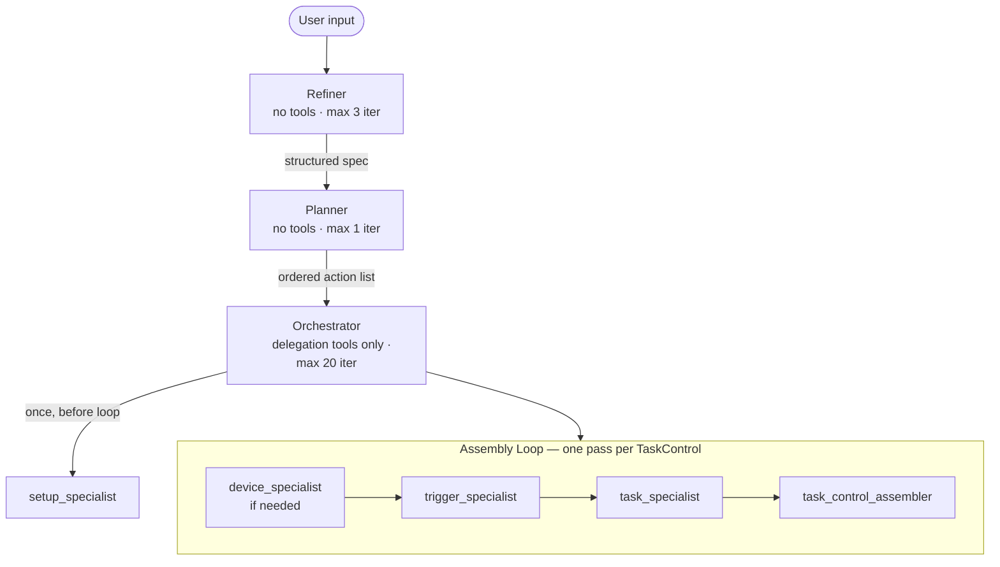
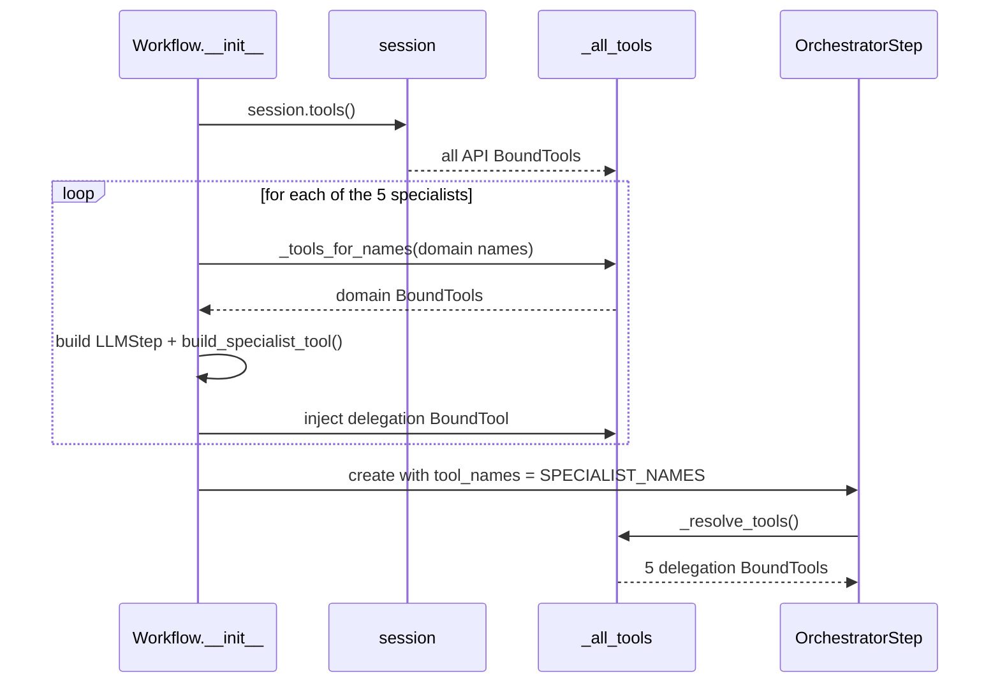
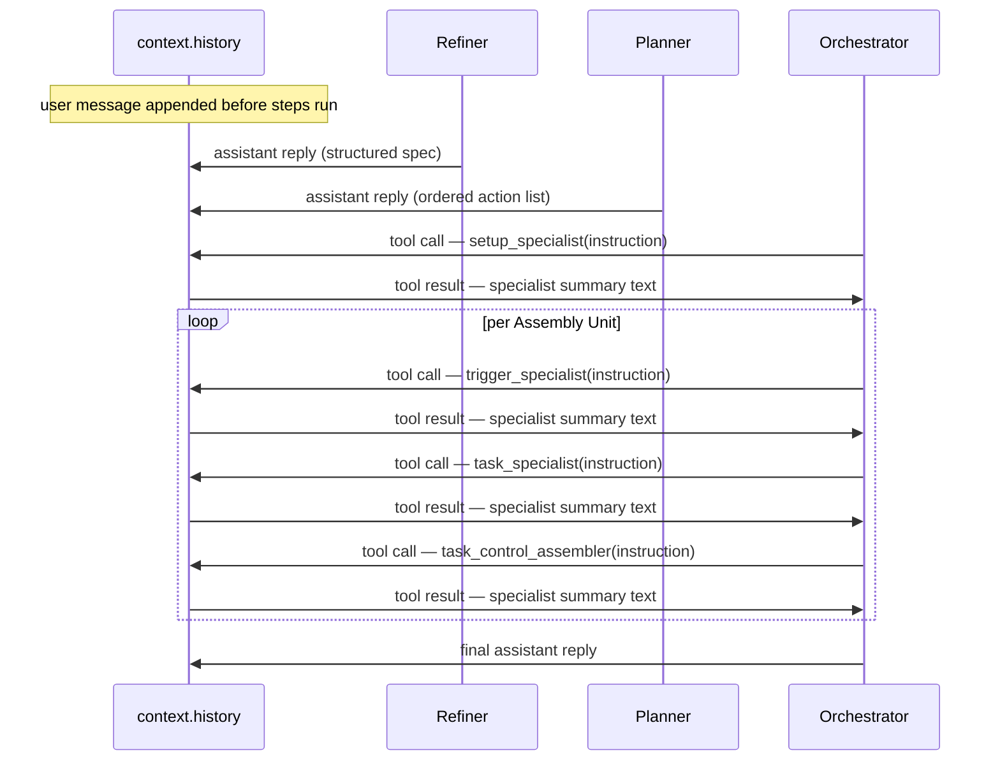

# One-Shot LLM Workflow

`OneShotLLMWorkflow` is the production workflow for protocol authoring. It takes a
single free-text user request and assembles a complete CARP study protocol in one
turn, using four cooperating LLM agents: a **refiner**, a **planner**, an
**orchestrator**, and a pool of **domain specialists**.

## Pipeline overview



All three main steps share `OneShotLLMWorkflowContext.history`, so each step sees the
full conversation up to that point. Specialist invocations run in isolated
`SpecialistContext` instances and do not touch the main history.

## Steps

### Refiner

Rewrites the user's free-text into a formal, structured specification. Runs without
tools; uses the `refiner.md` system prompt. The output is appended to the shared
history so the planner and orchestrator read a clean, unambiguous description rather
than the raw user message.

### Planner

Reads the refined specification and produces a concise ordered list of domain objects
to create — one item per line, in plain language. Runs in a single iteration without
tools. Its output anchors the orchestrator's Assembly Loop: each task control in the
plan corresponds to one Assembly Unit.

### Orchestrator

The orchestrator manages the Assembly Loop. It does not call API tools directly; its
entire tool set consists of the five delegation tools that invoke domain specialists.

**Assembly Loop — per TaskControl in the plan:**

1. Call `setup_specialist` once before the loop (idempotent — safe to call again if
   needed).
2. For each Assembly Unit:
   a. `device_specialist` — create the connected device or service, if any.
   b. `trigger_specialist` — create the trigger.
   c. `task_specialist` — create the task.
   d. `task_control_assembler` — bind trigger, task, and device into the TaskControl.

After all Assembly Units are complete the orchestrator emits a plain-text summary of
what was created, together with any Assumptions or Open questions.

## Specialists

Each specialist is an `LLMStep` wrapped as a `BoundTool` via `build_specialist_tool()`
in `engine/workflow/specialist.py`. The orchestrator calls them with a single
`DelegationRequest(instruction: str)` argument — a natural-language description
containing all names and parameters the specialist needs.

### Isolation model

Specialists run in fresh `SpecialistContext` instances containing only the delegation
instruction as the first user message. They have no access to the main conversation
history. To discover existing protocol state they use read-only API tools
(`get_triggers`, `get_tasks`, etc.) before making any mutation call — making each
specialist **idempotent**: calling it a second time for the same entity is safe.

### Tool subsets

Each specialist is given only the `BoundTool`s relevant to its domain. The subsets are
defined as named lists in `engine/tools/registry.py`.

| Specialist               | Domain                                            | API tools                                                                                                                                        |
| ------------------------ | ------------------------------------------------- | ------------------------------------------------------------------------------------------------------------------------------------------------ |
| `setup_specialist`       | Data endpoint, participant roles, primary devices | `add_data_endpoint`, `add_participant_role`, `get_participant_roles`, `add_primary_smartphone`, `add_primary_web_browser`, `get_primary_devices` |
| `device_specialist`      | Connected devices and services                    | `add_esense/movesense/movisens/polar`, `get_connected_devices`, `add_*_service`                                                                  |
| `trigger_specialist`     | All trigger types                                 | `add_immediate/delayed/periodic/cron/manual/no_op_trigger`, `get_triggers`                                                                       |
| `task_specialist`        | All task types                                    | `add_background/app/health_app/web_task`, `get_tasks`                                                                                            |
| `task_control_assembler` | TaskControl binding                               | `add_task_control`, `get_task_controls`, plus cross-domain reads                                                                                 |

The `task_control_assembler` also receives read-only access to triggers, tasks, and
devices so it can verify that all referenced entities exist before creating the binding.

### Delegation tool wiring



Adding delegation tools to `self._all_tools` lets `_resolve_tools()` work unchanged for
the orchestrator step.

## Configuration

`WorkflowConfig` keys consumed by this workflow:

| models key       | step                                     |
| ---------------- | ---------------------------------------- |
| `"refiner"`      | Refiner step                             |
| `"planner"`      | Planner step                             |
| `"orchestrator"` | Orchestrator step                        |
| `"specialist"`   | All five specialist steps (shared model) |

```yaml
models:
  refiner: "gpt-5.4-mini"
  planner: "gpt-5.4-mini"
  orchestrator: "gpt-5.4-mini"
  specialist: "gpt-5.4-mini"
parameters:
  api_base: "https://api.openai.com/v1/"
max_iterations:
  orchestrator: 20
  # specialist steps default to 5 each; override individually if needed:
  # trigger_specialist: 8
```

`max_iterations` keys for specialist steps (`setup_specialist`, `device_specialist`,
`trigger_specialist`, `task_specialist`, `task_control_assembler`) default to 5 each.

## Context and history

`OneShotLLMWorkflowContext` holds a single `history: list[Message]` (inherited from
`WorkflowContext`). The three main steps — refiner, planner, orchestrator — share this
list and append to it. Specialist invocations are invisible to it: the specialists run
in isolated `SpecialistContext` instances and their internal tool-call exchanges are
never written to the main history.



The orchestrator's tool-call messages record the delegation instruction and the
specialist's summary reply — providing full observability of the Assembly Loop in the
main history without embedding specialist-internal tool exchanges.

## Error handling

Pydantic `ValidationError` (raised when an LLM provides an argument that fails schema
validation before the API call) is caught in `call_tool()` and returned as a retryable
`ToolResult.error`. The specialist receives the full validation message — including the
list of valid enum values — and can correct its arguments on the next iteration.
`ApiException` from the server follows the same pattern: 4xx responses are retryable,
5xx and auth failures are not.

## Prompts

All prompt files live under `engine/prompts/one_shot/`.

| file                          | loaded by              |
| ----------------------------- | ---------------------- |
| `refiner.md`                  | Refiner step           |
| `planner.md`                  | Planner step           |
| `orchestrator.md`             | Orchestrator step      |
| `specialists/setup.md`        | setup_specialist       |
| `specialists/device.md`       | device_specialist      |
| `specialists/trigger.md`      | trigger_specialist     |
| `specialists/task.md`         | task_specialist        |
| `specialists/task_control.md` | task_control_assembler |

Every prompt receives the `{{inject: CAMS_info}}` substitution, which expands to the
full CAMS domain reference (devices, measures, trigger types, task types, task
controls).
