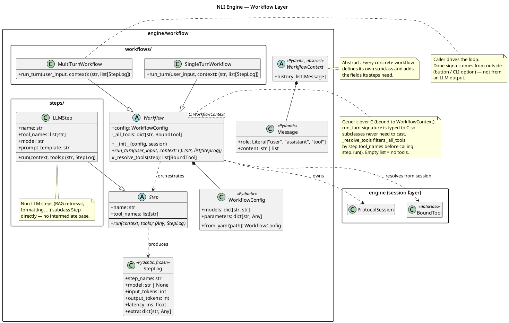

# Workflow layer



## Concept

The workflow layer sits above the session layer. Its job is to:

- Orchestrate a sequence of **Steps** against a `ProtocolSession` to satisfy a user request.
- Maintain full conversation state in a `WorkflowContext` passed across every step and turn.
- Keep structure separate from parameters: a workflow encodes _what runs and in what order_; `WorkflowConfig` encodes _which models and settings_ to use.
- Record a `StepLog` for every step so callers (CLI, GUI) have structured observability without touching step internals.

```
User ──▶ Workflow.run_turn() ──▶ [Step₁, Step₂, …] ──▶ ProtocolSession.tools() ──▶ LLM + Server
                ▲                        │
                └── WorkflowContext ─────┘   (flows through every step)
```

The caller drives the multi-turn loop. The done signal arrives from outside (a button in the GUI, an option in the CLI) — the workflow itself never decides to stop.

## Components

### `engine/workflow/config.py`

`WorkflowConfig` is a Pydantic model loaded from a YAML file. It carries one model ID per named step and an open `parameters` dict for anything else. Each concrete `Workflow` subclass validates that the keys it requires are present at construction time, before any LLM call fires.

```yaml
# Example workflow.yaml
models:
  refinement: claude-haiku-4-5-20251001
  executor: claude-sonnet-4-6
parameters:
  max_history_turns: 50
```

### `engine/workflow/log.py`

`StepLog` is a frozen Pydantic model. Every `Step.run()` call must produce one regardless of step type.

| field           | type             | meaning                                     |
| --------------- | ---------------- | ------------------------------------------- |
| `step_name`     | `str`            | identifies the step                         |
| `model`         | `str \| None`    | model used; `None` for non-LLM steps        |
| `input_tokens`  | `int`            | 0 for non-LLM steps                         |
| `output_tokens` | `int`            | 0 for non-LLM steps                         |
| `latency_ms`    | `float`          | wall-clock duration of the step             |
| `extra`         | `dict[str, Any]` | step-specific metadata (e.g. RAG hit count) |

### `engine/workflow/base.py`

Four abstractions live here.

**`Message`** — one message in LLM API format.

| field     | type                                   |
| --------- | -------------------------------------- |
| `role`    | `Literal["user", "assistant", "tool"]` |
| `content` | `str \| list`                          |

**`WorkflowContext`** — abstract Pydantic model; the shared mutable state. Never instantiated directly. Every concrete workflow defines its own subclass and adds the fields its steps need (e.g. `retrieved_chunks: list[str]` for a RAG workflow). The base carries only `history`.

| field     | type            | meaning                                         |
| --------- | --------------- | ----------------------------------------------- |
| `history` | `list[Message]` | full conversation history, never truncated here |

**`Step`** — abstract base for all step types. Steps receive the full context and only the tools they declared. Non-LLM steps (retrieval, formatting, validation, …) subclass `Step` directly. `LLMStep` (see below) is one concrete specialisation — there is no intermediate `DeterministicStep` base because it would add no shared behaviour.

| member                | type        | meaning                                         |
| --------------------- | ----------- | ----------------------------------------------- |
| `name`                | `str`       | unique within a workflow                        |
| `tool_names`          | `list[str]` | tools this step may call; empty list = no tools |
| `run(context, tools)` | abstract    | returns `(output, StepLog)`                     |

**`Workflow[C]`** — abstract base, generic over `C` (bound to `WorkflowContext`). The type parameter lets each concrete workflow declare its own context type in the signature of `run_turn`, so subclasses never need to cast.

| member                             | type                   | meaning                                   |
| ---------------------------------- | ---------------------- | ----------------------------------------- |
| `config`                           | `WorkflowConfig`       | validated at construction                 |
| `_all_tools`                       | `dict[str, BoundTool]` | all tools from the session, keyed by name |
| `run_turn(user_input, context: C)` | abstract               | returns `(response_text, list[StepLog])`  |
| `_resolve_tools(step)`             | protected              | filters `_all_tools` by `step.tool_names` |

### `engine/workflow/steps/`

| file     | class     | role                                                                                                                      |
| -------- | --------- | ------------------------------------------------------------------------------------------------------------------------- |
| `llm.py` | `LLMStep` | subclasses `Step`; calls an LLM with a prompt template and a tool subset; the step decides which history slice to forward |

### `engine/workflow/workflows/`

| file             | class                | behaviour                                                                |
| ---------------- | -------------------- | ------------------------------------------------------------------------ |
| `multi_turn.py`  | `MultiTurnWorkflow`  | runs the step sequence on every `run_turn` call; caller loops until done |
| `single_turn.py` | `SingleTurnWorkflow` | runs the step sequence once and is not called again                      |

## Step hierarchy

```
Step  (abstract — all step types)
 ├── LLMStep          calls an LLM; has model + prompt_template
 ├── RAGStep          retrieval; subclasses Step directly
 └── …                any other deterministic step
```

## Tool visibility

Every workflow holds all tools from the session. Each step receives only the subset it declared by name.

```
session.tools()  →  all BoundTools
                         │
              Workflow._all_tools (dict by name)
                         │
          ┌──────────────┴──────────────┐
     Step A                        Step B
   tool_names=["add_task"]     tool_names=[]   ← no tools
```

## Workflow usage

```python
config  = WorkflowConfig.from_yaml("workflow.yaml")
session = ProtocolSession(build_client(), name="My Study")
wf      = MultiTurnWorkflow(config, session)

context = MultiTurnContext(history=[])
while not done:
    user_input = input("> ")
    response, logs = wf.run_turn(user_input, context)
    print(response)
    # logs available for display or structured recording
```
